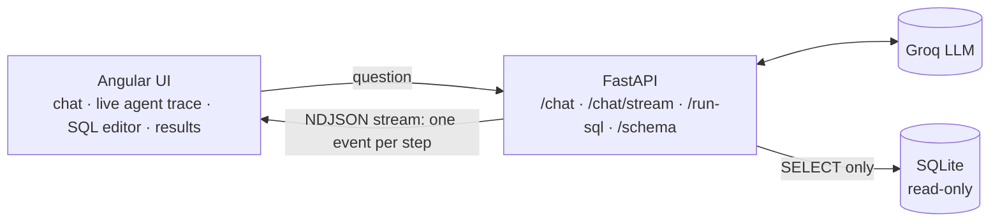
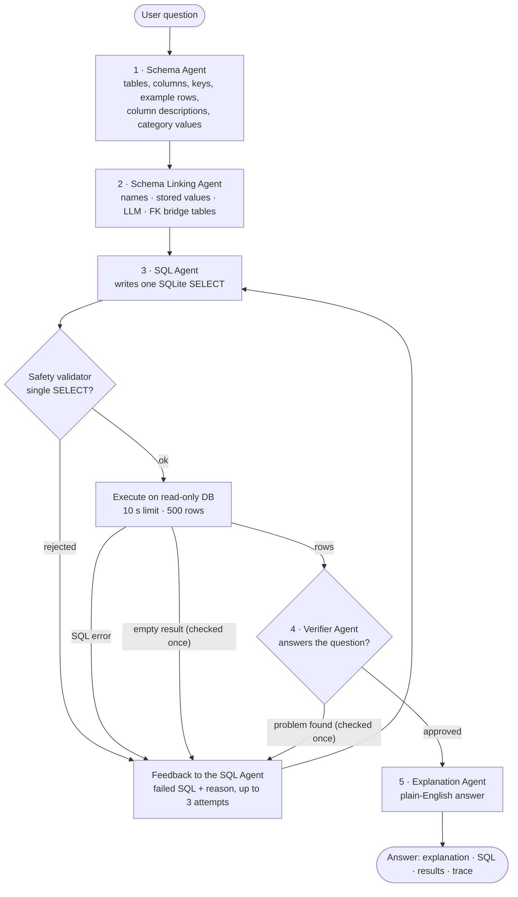

<div align="center">

# Text-to-SQL Analytics Agent

**Ask a database questions in plain English. Get the SQL, the results, and an explanation.**

A multi-agent LLM pipeline that links your question to the right tables, writes SQL,
runs it on a read-only connection, fixes its own mistakes, and explains the answer.


</div>

---

## Highlights

- **Schema linking:** narrows a large schema down to the tables the question needs, using
  name matching, stored-value matching (`"Kochi"` → `customers.city`), the LLM, and foreign-key
  paths for joins.
- **Self-correction loop:** failed SQL goes back to the model with the database's exact
  error, up to 3 attempts. Empty results and a separate **Verifier Agent** also trigger a revision.
- **Safe by design:** the model's SQL is never trusted. A code-level validator allows only a
  single `SELECT`, and the database is opened **read-only**, with a 10 s time limit and a 500-row cap.
- **Transparent UI:** every agent step streams live. You can see which tables were linked,
  every SQL attempt and why it was repaired, and edit and re-run the SQL yourself.
- **Measured:** an evaluation harness for the **BIRD mini-dev** benchmark (execution
  accuracy), with ablations for linking and self-correction.

---

## Architecture



### The agent pipeline



| Step | Type | What it does |
|---|---|---|
| **Schema Agent** | code | Reads the database structure. Adds optional column descriptions (`database_description/` CSVs) and lists the stored values of low-cardinality text columns, so the model filters on real values instead of guessing. |
| **Schema Linking Agent** | code + LLM | Picks the relevant tables and columns from four signals, then adds the bridge tables needed to join them. Falls back to the full schema when nothing matches. |
| **SQL Agent** | LLM | Writes the query. On a retry it sees every earlier attempt and its feedback as a conversation. |
| **Validator + executor** | code | One `SELECT`/`WITH` statement only, no write keywords, read-only connection, time and row limits. |
| **Verifier Agent** | LLM | Most wrong answers *run fine*. This agent checks the result's columns, the question's hints and the query logic, and sends specific feedback if something is off. |
| **Explanation Agent** | LLM | Answers the question in 2–4 sentences using the actual numbers. Result rows are treated as data, not instructions. |

A `no such table/column` error means linking left something out, so the pipeline **widens the
prompt to the full schema** for the next attempt.

---

## Benchmark

The agent is evaluated on **[BIRD mini-dev](https://github.com/bird-bench/mini_dev)**: 500
questions over 11 real-world databases, at three difficulty levels.

**Metric: execution accuracy (EX)**, BIRD's official metric. A prediction counts as correct
when it returns the same set of rows as the reference SQL. Each run also reports:

- **First-attempt EX:** accuracy before any self-correction, which isolates what the loop adds.
- **Repair stats:** how many queries failed, were repaired, and ended up correct.
- **Linking recall:** the share of questions where every table the reference SQL uses was linked.
- **Cost:** LLM calls, tokens and seconds per question.

### Results

Model `openai/gpt-oss-120b` (Groq), schema linking on, up to 3 attempts, BIRD evidence hints on.
Full run: 499 of 500 questions scored (one reference query cannot be scored).

| Difficulty | Questions | EX | First attempt |
|---|---|---|---|
| Simple | 148 | 77.0% | 75.7% |
| Moderate | 250 | 57.2% | 55.6% |
| Challenging | 101 | 52.5% | 52.5% |
| **Total** | **499** | **62.1%** | **60.9%** |

- **Self-correction:** fixed 6 wrong answers and broke none (+1.2 points).
- **Schema linking recall:** 97.8% of questions had every needed table linked.
- **Cost:** about 2.0 LLM calls and 4,400 tokens per question.

**Ablation: does schema linking help?** Same 100 random questions (seed 0), only linking changed.

| Configuration | Questions | EX | First attempt | LLM calls / question |
|---|---|---|---|---|
| With schema linking | 100 | 73.0% | 70.0% | 2.04 |
| Without schema linking | 100 | 71.0% | 66.0% | 1.08 |

Linking adds about 2 points of EX for one extra LLM call per question. With 100 questions the gap is
small, so read it as a modest gain. Full reports and per-database scores are in
[`backend/benchmarks/README.md`](backend/benchmarks/README.md).

### Run it yourself

1. Download BIRD mini-dev and unpack it so the folder holds `mini_dev_sqlite.json` and
   `dev_databases/<db_id>/<db_id>.sqlite`.
2. From the `backend` folder:

```powershell
python -m benchmarks.bird_eval --data C:\path\to\minidev --limit 100        # random sample (seed 0)
python -m benchmarks.bird_eval --data C:\path\to\minidev                    # all 500 questions
python -m benchmarks.bird_eval --data C:\path\to\minidev --no-linking --out benchmarks/results/no_linking.jsonl
python -m benchmarks.bird_eval --data C:\path\to\minidev --max-attempts 1 --out benchmarks/results/one_attempt.jsonl
python -m benchmarks.bird_eval --report                                     # re-print a summary
python -m benchmarks.compare benchmarks/results/a.jsonl benchmarks/results/b.jsonl
```

Runs are **resumable**: results are appended one line per question, so re-running the same
command continues where it stopped. When Groq's daily token limit is hit, the run waits for
quota by default (`--no-wait` stops instead). Other options: `--first N`, `--seed`, and
`--no-evidence` to leave out BIRD's hints.

---

## Quick start

You need **Python 3.10+**, **Node 20+** and a free **[Groq API key](https://console.groq.com/keys)**.

### 1. Backend

```powershell
cd backend
python -m venv .venv
.venv\Scripts\Activate.ps1          # macOS/Linux: source .venv/bin/activate
pip install -r requirements.txt
```

Create `backend\.env`:

```env
GROQ_API_KEY=your-key-here
GROQ_MODEL=openai/gpt-oss-120b
DB_PATH=data/sample.sqlite
```

```powershell
uvicorn app.main:app --reload
```

The API runs at http://localhost:8000, with interactive docs at http://localhost:8000/docs.

### 2. Frontend

```powershell
cd frontend
npm install
npm start
```

Open **http://localhost:4200** and try:

- *Show me the top 5 customers by total revenue*
- *Which city has the most orders?*
- *Total revenue from customers in Kochi by product category*
- *Monthly revenue for 2025*

The included `data/sample.sqlite` is a small shop database (customers, products, orders).
To query **your own database**, point `DB_PATH` at any SQLite file and restart the backend.

<details>
<summary><b>Using the UI</b></summary>

- The sidebar lists the tables. Click a column to add it to your question. Tables used by the
  latest answer are marked **LINKED**.
- Each answer shows the agent steps (linked tables, matched values, every SQL attempt and what
  triggered a repair), the explanation, the SQL and the results.
- **Edit** the SQL and re-run it (Ctrl+Enter). It goes through the same validator and
  read-only connection. **Reset** restores the original.
- Click a column header to sort. **Copy CSV** / **Download** to export.
- Keys: Enter sends · Shift+Enter adds a line · ↑ recalls the last question · / focuses the box.
- Light and dark themes follow your system setting.

</details>

<details>
<summary><b>API reference</b></summary>

| Endpoint | What it does |
|---|---|
| `GET /schema` | Tables, columns, keys, example rows |
| `POST /chat` `{"question": "..."}` | Runs the pipeline and returns the answer |
| `POST /chat/stream` `{"question": "..."}` | The same, streamed as NDJSON (one event per line) |
| `POST /run-sql` `{"sql": "..."}` | Runs user-edited SQL (validated, read-only, no LLM) |

Example `POST /chat` response:

```json
{
  "question": "Total revenue from customers in Kochi by product category",
  "sql": "SELECT p.category, SUM(o.amount) AS total_revenue FROM ...",
  "columns": ["category", "total_revenue"],
  "results": [["Electronics", 537500.0], ["Furniture", 158400.0]],
  "explanation": "Customers in Kochi generated ...",
  "truncated": false,
  "trace": {
    "linking": {
      "tables": ["customers", "orders", "products"],
      "values": [{"table": "customers", "column": "city", "value": "Kochi"}],
      "method": "lexical+value+llm",
      "total_tables": 3
    },
    "attempts": [{"n": 1, "sql": "...", "ok": true, "rows": 4, "ms": 2}],
    "widened": false,
    "total_ms": 2700
  }
}
```

Stream events: `status` (a step started), `linking`, `attempt` (one per SQL attempt),
`widened`, then `result` or `error`.

Errors on `/chat`: `422` when there is no working query after 3 attempts (includes the last
SQL tried), `502` when the LLM call fails, `500` when the database file is missing.

</details>

---

## Safety

The SQL comes from an LLM, so it is treated as **untrusted input**. There are two independent locks:

1. **Validator** (`services/sql_validator.py`): exactly one statement, which must start with
   `SELECT` or `WITH`. Whole-word checks block `INSERT`, `UPDATE`, `DELETE`, `DROP`, `ALTER`,
   `CREATE`, `ATTACH`, `PRAGMA` and similar. Text inside quotes is ignored, so
   `WHERE note = 'drop'` and columns like `created_at` are fine.
2. **Read-only database** (`database/connection.py`): opened with `mode=ro` and
   `PRAGMA query_only`, so even a query that slipped past the validator could not write.

Queries are also stopped after **10 seconds** and capped at **500 rows**. The Explanation Agent
is told to ignore any instructions found inside result rows (prompt-injection defence).

> **Note:** the app can read every table in the database it is pointed at. For sensitive data,
> point it at a database or copy that contains only the tables users may query.

---

<details>
<summary><b>Project structure</b></summary>

```
backend/
├── app/
│   ├── main.py                    FastAPI app + CORS
│   ├── config.py                  reads backend/.env
│   ├── api/chat.py                endpoints
│   ├── agents/
│   │   ├── pipeline.py            the agent loop: link → generate → validate → run → review → explain
│   │   ├── schema_agent.py        schema → prompt text (whole, or only linked tables)
│   │   ├── schema_linking.py      names · stored values · LLM · foreign-key closure
│   │   ├── sql_agent.py           question + earlier attempts and feedback → SQL
│   │   ├── verifier.py            checks a result actually answers the question
│   │   └── explanation_agent.py   results → plain-English answer
│   ├── database/
│   │   ├── connection.py          read-only SQLite connection
│   │   ├── schema.py              tables, columns, keys, example rows
│   │   └── descriptions.py        optional column documentation (BIRD CSV format)
│   ├── services/
│   │   ├── llm.py                 Groq client: retries, rate limits, token counts
│   │   ├── sql_validator.py       safety check (not AI)
│   │   └── sql_executor.py        time and row limits
│   └── models/request.py          request/response shapes
├── benchmarks/
│   ├── bird_eval.py               BIRD mini-dev evaluation harness
│   └── compare.py                 question-by-question diff of two runs
├── tests/test_agents.py           offline tests with a fake LLM
└── data/sample.sqlite             sample shop database

frontend/src/app/
├── pages/chat/                    sidebar + conversation, consumes the event stream
├── components/
│   ├── agent-trace/               live agent steps: linking, attempts, repairs
│   ├── sql-display/               highlighted SQL, copy, edit, re-run
│   ├── results-table/             sortable results, single-value view, CSV export
│   ├── schema-panel/              tables and columns, linked tables marked
│   └── chat-input/                question box
├── services/sql-ai.service.ts     HTTP + streaming client
└── format.ts                      SQL highlighting, number formatting, CSV
```

</details>

---

## Tests

```powershell
cd backend
python -m pytest
```

The tests run **offline with a fake LLM**. They cover schema linking (names, stored values,
fuzzy matches, foreign-key bridges, invented table names), the self-correction loop (repair
from an error, from the validator, after an empty result, after a verifier review, schema
widening, giving up after 3 attempts), column descriptions, and validator edge cases.

---

## Built with

FastAPI · Pydantic · httpx · SQLite · Angular · TypeScript · Groq (`openai/gpt-oss-120b`) · pytest
